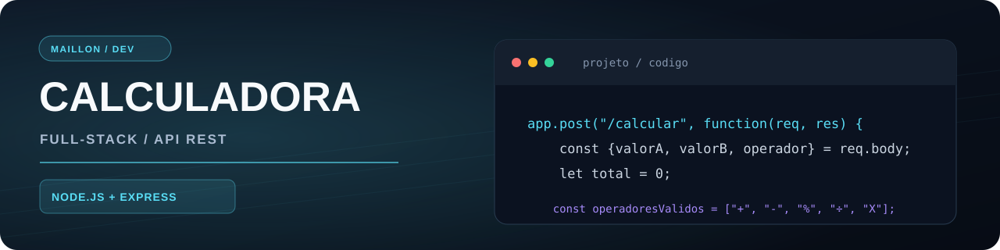
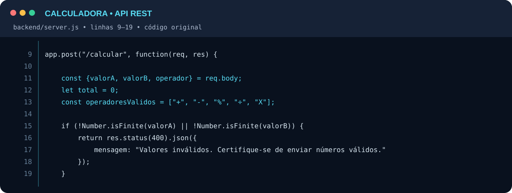
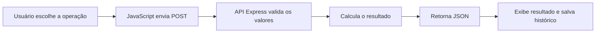

<p align="center">
  
</p>

<h1 align="center">Calculadora Full-Stack com API</h1>

<p align="center">
  
  
  
  
  
</p>

> Calculadora web com operações matemáticas processadas por uma API REST. Um projeto focado na comunicação entre front-end e back-end, validação de dados e experiência do usuário.

🧮 **[Testar calculadora](https://maillon49-prog.github.io/calculadora-Com-API/)** · 💻 **[Ver código](https://github.com/maillon49-prog/calculadora-Com-API)**

## ✨ O que o projeto faz

- ➕ Soma, subtração, multiplicação, divisão e porcentagem
- ✅ Valida os valores e os operadores enviados à API
- 🚫 Evita divisão por zero
- 🕘 Mantém o histórico de cálculos no `localStorage`, com opção de limpar
- 🔄 Envia requisições com `fetch` para o servidor Express

## 🛠️ Tecnologias

| Interface | API | Persistência |
| :-- | :-- | :-- |
| HTML, CSS e JavaScript | Node.js, Express e CORS | `localStorage` no navegador |

## 💻 Um trecho real do meu código

Imagem criada diretamente a partir do arquivo [`backend/server.js`](https://github.com/maillon49-prog/calculadora-Com-API/blob/main/backend/server.js#L9-L19), linhas 9–19. O conteúdo do trecho foi mantido exatamente como está no repositório.

<p align="center">
  
</p>

## 🧭 Como funciona



### Exemplo de requisição

`POST /calcular`

```json
{
  "valorA": 10,
  "valorB": 5,
  "operador": "+"
}
```

**Resposta de sucesso (`200`):**
```json
{ "mensagem": 15 }
```

Em requisições inválidas, a API pode responder com `400`, incluindo uma mensagem explicativa.

## 🚀 Executar localmente

**Requisitos:** Node.js e npm.

```bash
git clone https://github.com/maillon49-prog/calculadora-Com-API.git
cd calculadora-Com-API/backend
npm install
npm start
```

Depois, abra `frontend/index.html` no navegador. O front-end do repositório também está configurado para utilizar a API hospedada no Render.

## 📁 Organização do projeto

```text
calculadora-Com-API/
├── backend/        # API Express e package.json
├── frontend/       # Interface HTML, CSS e JavaScript
└── README.md
```

## 🎯 O que pratiquei

Requisições HTTP, tratamento de erros, validação de entrada, lógica matemática no servidor e separação de responsabilidades entre interface e API.

---

### 👨‍💻 Autor

Desenvolvido por **Maillon Andrade de Oliveira**, como parte dos meus estudos e projetos práticos de programação.

[GitHub](https://github.com/maillon49-prog) · [Portfólio](https://github.com/maillon49-prog/Portifolio)
